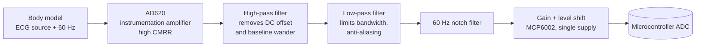

# ECG Analog Front-End for a Stress Monitor (Proteus) · 🚧 work in progress

The analog signal chain that picks up the heart's electrical activity (ECG) through skin electrodes and conditions it so a microcontroller can digitize it. It is the first stage of a **stress monitor**: once the ECG can be read cleanly, heart rate and heart-rate variability (HRV) can be computed from it, and both are common physiological indicators of stress.

> Course project, B.Sc. Mechatronics Engineering, Universidad Militar Nueva Granada. **Currently in progress.**


## Why it is hard

An ECG is only about **1 mV** at the skin, yet it sits on top of much larger interference:

- **Common-mode 60 Hz** pickup from the power line, coupled through the body.
- **Electrode offset and baseline wander** from motion and breathing, below about 0.5 Hz.
- **High-frequency noise** from muscle activity (EMG) and the environment.

The front-end has to amplify the tiny differential signal and reject everything else.

## Signal chain

A simplified block view; the exact order and component values are in the Proteus schematic.



| Stage | Part | Role |
|---|---|---|
| Instrumentation amplifier | **AD620** | Differential gain with high common-mode rejection, gain set by R<sub>G</sub> |
| Active filters | **TL074** (quad op-amp) | High-pass, low-pass and notch stages |
| Output stage | **MCP6002** (rail-to-rail) | Final gain and offset to fit the ADC input range |
| Stimulus | Proteus generators | A body-voltage model plus 60 Hz interference to test rejection |

## Files

```
proteus/ecg_front_end.pdsprj              full schematic + simulation
proteus/ecg_front_end_simplified.pdsprj   simplified variant for faster simulation
```

Open them with **Proteus 8.x**. They include virtual instruments (oscilloscope, AC/DC meters) for checking each stage.

## Roadmap

- [x] Instrumentation-amplifier stage (AD620)
- [x] Active filters + 60 Hz notch (TL074)
- [x] Single-supply output stage (MCP6002)
- [ ] Add schematic and oscilloscope screenshots to this README
- [ ] Measure the frequency response and CMRR of each stage in simulation
- [ ] Digitize with an ESP32 and detect R-peaks → heart rate and HRV
- [ ] Map HRV features to a stress index

---

<details>
<summary><b>🇪🇸 Versión en español</b></summary>

## Front-end analógico de ECG para un medidor de estrés (en progreso)

Cadena analógica que capta la señal del corazón (ECG) con electrodos y la acondiciona para que un microcontrolador pueda leerla. Es la primera etapa de un medidor de estrés que calculará la frecuencia cardiaca y su variabilidad (HRV).

- **AD620:** amplificador de instrumentación con alto rechazo en modo común.
- **TL074:** filtros activos pasa altas, pasa bajas y notch de 60 Hz.
- **MCP6002:** etapa de salida con alimentación simple, para ajustarse al rango del ADC.

Los archivos son de Proteus 8 e incluyen instrumentos virtuales para revisar cada etapa.

**Siguiente paso:** digitalizar la señal con un ESP32, detectar los picos R y calcular la frecuencia cardiaca y la HRV.

</details>
